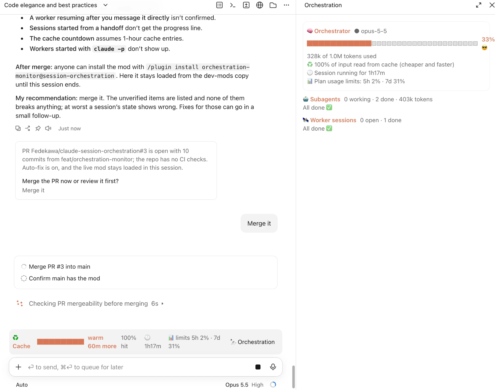
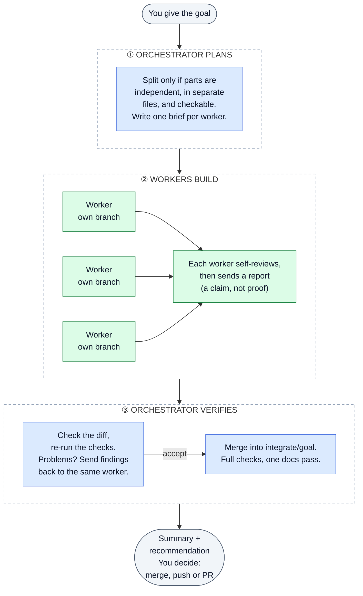
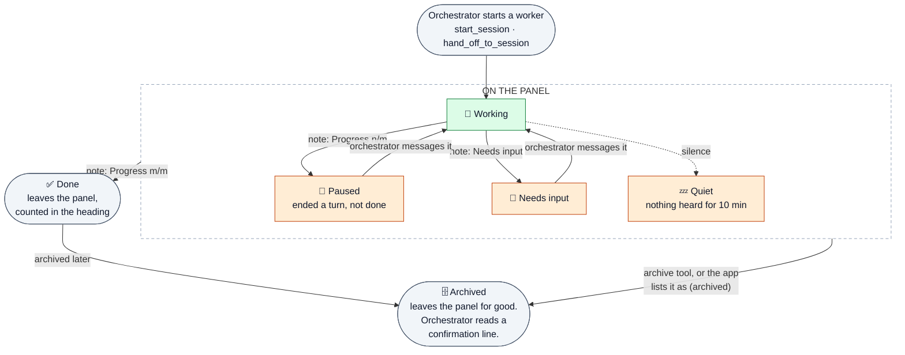

# claude-session-orchestration

A Claude Code marketplace, `session-orchestration`, with two plugins for running an orchestrator session with worker sessions.

| Plugin | What it is |
|---|---|
| [`orchestrator-workers`](plugins/orchestrator-workers/README.md) | Skills and agents: how to split work, brief workers, keep them isolated, review what comes back, integrate it, and keep the docs honest. Plain Markdown. |
| [`orchestration-monitor`](plugins/orchestration-monitor/README.md) | An optional mod: the orchestrator's cache timing and usage limits above the prompt, and an `/orchestration` panel with each subagent's and worker session's progress. Ships a TypeScript hooks module. |



## How it works

One session, the **orchestrator**, owns the goal. It splits off only the parts that are truly independent, hands each one to a **worker** (a subagent or its own session) with a self-contained brief, then verifies every worker's report against the actual diff before integrating. You make the final call.



Three rules carry most of the value:

1. **Split only what is truly independent.** Disjoint files, no shared output, a checkable "done when". Everything else stays in one session.
2. **A brief is the whole world.** A worker knows only what its brief says, so hand over understanding, not just a task.
3. **A report is a claim.** The orchestrator verifies against the diff before anything is called done.

The skills behind each phase, the agents, and how workers can be launched are in the [`orchestrator-workers` README](plugins/orchestrator-workers/README.md).

### Watching it live

`orchestration-monitor` asks every worker to open its end-of-turn note with a progress line, reads those notes as they reach the orchestrator, and draws one card per worker. A card moves like this:



Subagents work the same way, except they report through a `step` tool and leave the panel when they finish (a failed one stays). Details, limits and privacy are in the [`orchestration-monitor` README](plugins/orchestration-monitor/README.md).

## Install

In Claude Code:

```text
/plugin marketplace add Fedekawa/claude-session-orchestration
/plugin install orchestrator-workers@session-orchestration
/plugin install orchestration-monitor@session-orchestration
```

`orchestrator-workers` used to be called `session-orchestration`. The marketplace renames existing installs; run its install line once.

## Contributing

Issues and pull requests are welcome. Keep changes small and in the spirit of the repo: the simplest thing that works, general enough for anyone's project, and no mention of a specific company, client or private tool. A change to a plugin's skills, agents or code raises the `version` in that plugin's `.claude-plugin/plugin.json`, or installed copies never see it.

## License

MIT. See [LICENSE](LICENSE).
