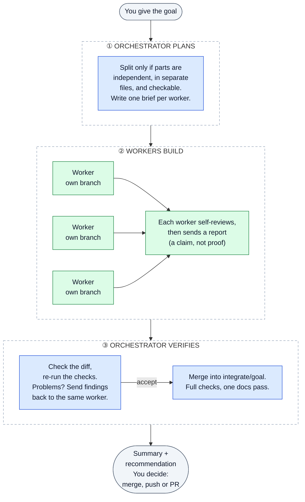
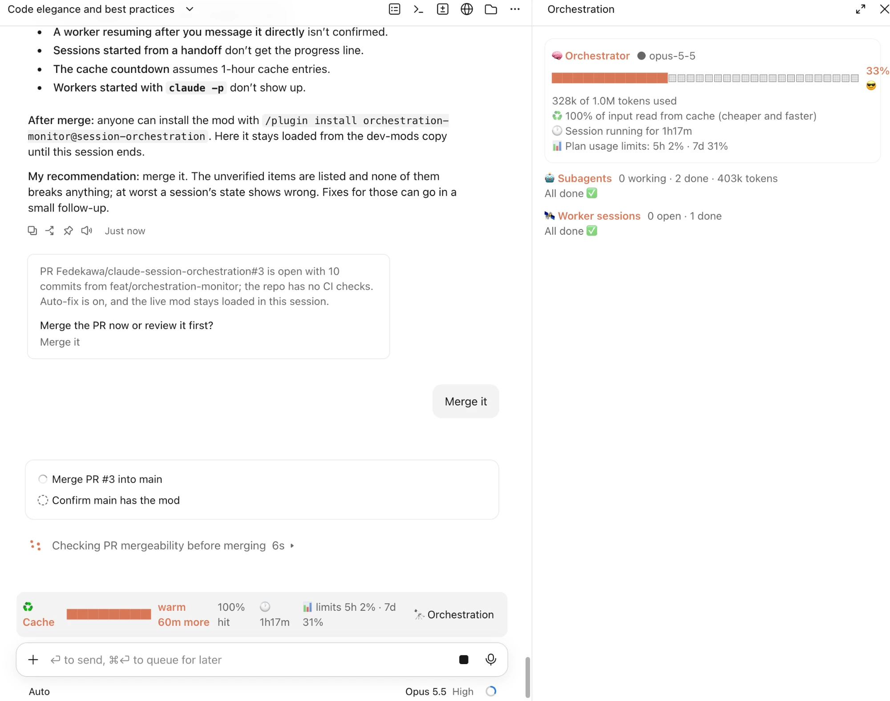

# session-orchestration

Skills and agents for running **an orchestrator Claude Code session (also called a lead or main session) with worker sessions**: how to split work, brief workers, keep them isolated, review what comes back, integrate it, and keep the docs honest while you do.

The skills and agents are plain Markdown: no runtime, no dependencies, and nothing specific to one language, framework or host. An optional mod adds a live view of the orchestration (see below).

## Install

In Claude Code:

```text
/plugin marketplace add Fedekawa/claude-session-orchestration
/plugin install session-orchestration@session-orchestration
```

Or try it without installing, from a local clone:

```bash
git clone https://github.com/Fedekawa/claude-session-orchestration
claude --plugin-dir ./claude-session-orchestration
```

## The model in sixty seconds



Skills by phase: ① `orchestrating-sessions`, `writing-session-briefs` · ② `working-as-a-session`, `self-review-before-handoff`, `syncing-docs-with-code` · ③ `reviewing-session-work`, `orchestrating-sessions`, `syncing-docs-with-code`.

Three rules carry most of the value:

1. **Split only what is truly independent.** Disjoint files, no shared output, a checkable "done when". Everything else stays in one session.
2. **A brief is the whole world.** A worker knows only what its brief says, so hand over understanding, not just a task.
3. **A report is a claim.** The orchestrator verifies against the diff before anything is called done.

## What is inside

### Skills

| Skill | Use it when |
|---|---|
| `orchestrating-sessions` | You are the orchestrator. Decide here / subagent / own session, split, dispatch, isolate, integrate, close out. |
| `writing-session-briefs` | You are about to hand a task to another session or subagent. Template and checklist. |
| `working-as-a-session` | You are the worker. Scope, branch discipline, escalation, and the report format. |
| `self-review-before-handoff` | You are about to say "done". Review your own diff, run the checks, sync docs, write an honest report. |
| `reviewing-session-work` | A worker says it is finished. Verify the claim, decide accept / rework / reject. |
| `syncing-docs-with-code` | Behaviour, API or config changed. Find the docs that describe it, update or flag them, and know which side is the truth. |

### Agents

| Agent | Role | Tools |
|---|---|---|
| `session-planner` | Decides whether to split a goal, and how: work units, conflict map, choke points. | read-only |
| `work-reviewer` | Fresh-context review of a diff against its brief. Does not trust the report. | read + run checks |
| `docs-drift-auditor` | Finds docs that no longer match the code, with proposed fixes. | read + safe commands |

The agents never edit files. Models are set in each agent's frontmatter (`opus` for the planner and reviewer, `sonnet` for the auditor); change them to taste, or use `inherit` to follow your session's model.

### Optional mod: orchestration-monitor

A separate plugin in this marketplace, for watching an orchestration live: the orchestrator's cache timing, session age and usage limits above the prompt, and an `/orchestration` panel with each subagent's and worker session's progress, and a button to ask the orchestrator to look at a stalled one. Unlike the skills it ships code (a TypeScript hooks module). See [its README](plugins/orchestration-monitor/README.md).



```text
/plugin install orchestration-monitor@session-orchestration
```

### Installed names

Plugin components are namespaced, and `subagent_type` must match exactly:

| Kind | Name |
|---|---|
| Skill | `/session-orchestration:orchestrating-sessions` (same pattern for the other five) |
| Agent | `session-orchestration:session-planner`, `session-orchestration:work-reviewer`, `session-orchestration:docs-drift-auditor` |

## Quick start

Once installed, ask for the behaviour you want in plain language. For example:

- "Use the orchestrating-sessions skill: split this into independent parts and run them as separate sessions."
- "Write a brief for a worker to add pagination to the orders endpoint."
- "You're a worker session. Here is your brief: ... Follow working-as-a-session."
- "Review what the worker produced on branch `feat/x` with reviewing-session-work."
- "Run syncing-docs-with-code on this branch before I open the PR."

## How workers run

The skills describe the protocol (brief, branch, report), not a particular launcher, so they work with any of these:

| Mechanism | Result comes back as |
|---|---|
| Subagent (Agent tool) | Its final message |
| A host's session-spawning tool, such as a desktop app's | A notification or report when it ends a turn |
| Headless run: `claude -p` in a worktree, brief read from a file | stdout (JSON with `--output-format json`) |
| A terminal tab you drive: `claude` in a worktree | You paste the report, or it writes it outside the work tree |

Anything that writes code, subagents included, should get its own git worktree:

```bash
git worktree add ../myrepo-unit-a -b feat/unit-a main
```

Headless workers have nobody to answer permission prompts. Pre-approve only what the brief needs and cap the spend; `orchestrating-sessions` has the exact command. Never paste a brief inside double quotes, because the shell would run any backticks in it.

## Principles behind the defaults

- **One writer per file, one owner per shared file.** Lockfiles, index exports, route tables, migrations, schemas, `CLAUDE.md`, top-level README and CHANGELOG all have exactly one owner, usually the orchestrator at integration.
- **Contracts first.** When parts share an interface, the orchestrator commits it before dispatching, and workers receive it read-only.
- **Safe by default.** Workers do not push, open PRs, deploy, migrate or touch production unless the brief says so and a human approved it.
- **The simplest code that works is the most elegant.** Every worker starts from this standard, every brief can restate it, and every review treats speculative abstractions, unrequested options and non-surgical edits as findings. Adapted from [Andrej Karpathy's notes on LLM coding pitfalls](https://x.com/karpathy/status/2015883857489522876).
- **Docs are part of the change.** Code, then docs, then self-review, then orchestrator review. Code wins over docs that describe behaviour; specs and ADRs are never silently overruled.
- **Escalate early.** A fast, well-described blocker beats three more attempts at the same wall.
- **Decisions are multiple choice.** When the orchestrator needs the user's input it explains what the decision is about and offers at least three alternatives with pros and cons, one of them recommended. The user answers with a letter.
- **Honest reports.** "Verified" means run and observed. Failing checks are reported as failing.

## Contributing

Issues and pull requests are welcome. Keep changes small and in the spirit of the repo: the simplest thing that works, general enough for anyone's project, and no mention of a specific company, client or private tool.

## License

MIT. See [LICENSE](LICENSE).
