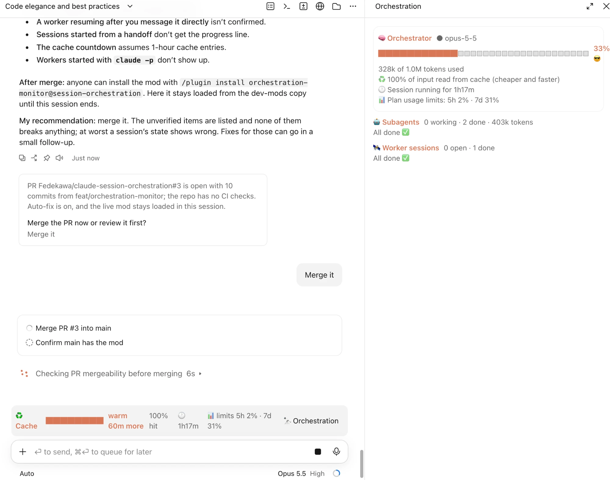
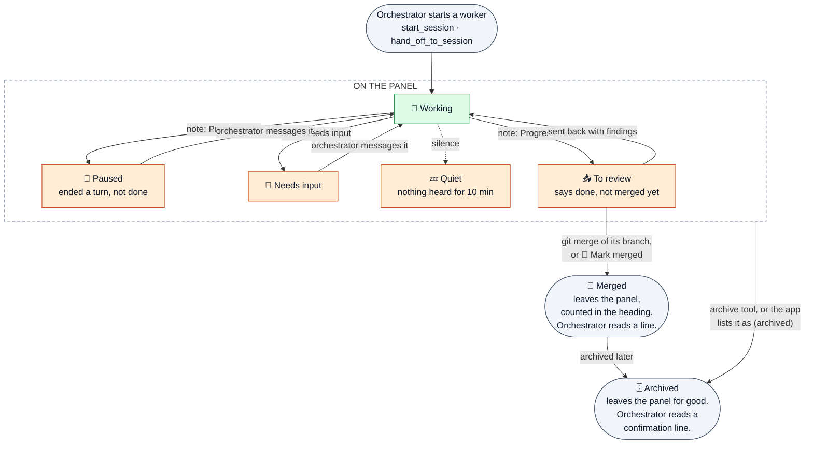

# orchestration-monitor

A Claude Code mod that shows what an orchestrator session is doing, how much room it has left and whether its cache is still warm. It goes with the `orchestrator-workers` skills and works on its own.



"Context" is the orchestrator's context window: how much of what the model can hold at once is already used. When it fills up, Claude Code compacts the conversation and detail is lost, so an orchestrator wants to see it coming.

- **Cache band**, above the prompt:
  - ♻️ **Cache**: how long the orchestrator's prompt cache stays warm, as a meter counting down the hour since its last request (`warm 47m more`), then `❄️ cold` once it has expired, when the next reply sends the whole conversation again (slower, and it counts more against your limits). Beside it, the share of input tokens read from the cache this session (`92% hit`).
  - 🕐 how long this session has been running.
  - 📊 **limits**: how much of your plan's 5-hour and 7-day usage allowance is used.
  - A button that names what is in flight (`🤖 2 working · 🛰️ 1 active · 🙋 1 to check`) and opens the panel.
- **Orchestration panel** (`/orchestration` toggles it), one card per item. It opens by itself the first time the orchestrator delegates.
  - **Orchestrator**: context meter, model, cache hit rate, session age, usage limits. From 70% it suggests delegating or `/compact`.
  - **Subagents**: only the running ones, and any that failed; a finished one leaves the panel and is counted in the heading. Each card shows how far it is (`██░░ 2/4 tokenizer done`), what it is doing right now (`now Edit parser.ts`), model, context, tokens and how long it has run (🕐).
  - **Worker sessions**: every one not yet merged, each with how far it is, and whether it is working, paused without being done, waiting for an answer, quiet for 10 minutes, or **📥 to review**: it says it is done, but only a merge counts. The first three get a **👀 Ask the orchestrator to look** button, which sends the orchestrator a message to check on that session and unblock it. A card to review gets **🔍 Ask the orchestrator to review it** and **🔗 Mark merged**. The band's button counts them (`📥 2 to review`): the review queue is what limits how many workers can usefully run.
  - An **archived** worker session leaves the panel for good, counted in the heading (`1 archived`); a later note from it does not bring it back. The mod sees an archive when the orchestrator calls a session archive tool (any `…__archive_session`, the desktop app's or the cloud's) or when the app lists the session as `(archived)`. Either way the orchestrator gets a one-line confirmation beside what it reads next, that the session is archived and off the panel; if the archive tool fails, it reads that the session stays.

## How progress is reported

- **Subagents**: the mod adds one line to every subagent's brief asking it to call the `step` tool the mod provides, with its plan's size and each step as it finishes. The "now" line needs nothing from the subagent: it is the latest tool it called.
- **Worker sessions**: the mod adds one line to every worker session's brief asking it to start each end-of-turn summary with `Progress: <done>/<total> — <note>`, or `Needs input: <question>` when it stops for an answer, and to end it with `Branch: <its git branch>`. The orchestrator reads that line in the note the desktop app sends when the session ends a turn, so a session's progress moves once per turn, not live.

## A worker session's card

Each worker session's card moves through these states. Every arrow comes from something the orchestrator sees: the tool call that starts or archives the session, the note the desktop app delivers at the end of each of its turns, or the orchestrator messaging it again.



- **Paused**, **Needs input** and **Quiet** (orange) light the card and give it the 👀 button.
- **To review** is the worker's claim that it is done. It stays until its branch is merged: the mod sees a `git merge` the orchestrator runs that names the branch (from the brief's `branch <name>`, the start tool's input, or the `Branch:` line the mod asks each worker to end its notes with), or you press **🔗 Mark merged**. A merge that fails leaves it to review.
- **Merged** leaves the panel and is counted in the heading, and the orchestrator reads a line saying so.
- **Archived** leaves the panel for good, counted as `n archived`; a later note or message cannot bring it back. The orchestrator reads one line beside the archive result (or beside its next prompt when the app reported it) confirming the session is archived and off the panel. A failed archive tells it the session stays.

## Limits

- The cache countdown assumes 1-hour cache entries, which Claude Code writes on a subscription. A session writing 5-minute entries goes cold sooner than shown.
- A merge is seen only from a `git merge` in the orchestrator's own shell. A merge on GitHub, a squash merge, a rebase or a cherry-pick is not: press **🔗 Mark merged**.
- Worker sessions are separate processes, so their tokens and context are not visible here: only what their end-of-turn notes say.
- A session archived from the app's own UI is caught only if the app's linked-sessions line marks it `(archived)`; one that just drops off that line stays on the panel.
- Worker sessions are picked up from the Claude desktop app's session tools (`start_session`, `hand_off_to_session`). Workers started another way, such as `claude -p` in a terminal, do not appear. The note format is the desktop app's; if it changes, sessions stay at "working".

## Privacy

The mod sends nothing off your machine and has no service of its own. Everything it shows comes from the running session and lives only in that session's memory: it writes no files and keeps nothing after the session ends.

- **Reads:** the session's context fill, token counts, model and plan usage limits; the name of each tool call and a short hint from its input (a file name, search pattern or the first 60 characters of a command), to show what a subagent is doing; the orchestrator's shell commands that run `git merge`, to see which worker branches were merged; and each prompt the orchestrator receives, to find the end-of-turn notes the desktop app delivers from worker sessions and read their progress line. Other prompt text is ignored.
- **Changes:** it appends the one-line progress request described above to each subagent's and worker session's brief. When a worker session is archived or its branch is merged, it adds a one-line confirmation, naming that session, to what the orchestrator reads.
- **Sends:** only when you press **👀 Ask the orchestrator to look** or **🔍 Ask the orchestrator to review it**, a fixed message naming that worker session goes to the orchestrator as your prompt, the same as if you had typed it. The exact text is under [Prompts it submits](#prompts-it-submits).
- **Credentials:** it reads none. The plan usage limits come from the session's own usage figures (`$.session.usage()`), the same numbers Claude Code shows, and nothing it reads leaves the session.

## What each hook does

The hooks module is [`hooks/register.tsx`](hooks/register.tsx). It registers no permission hook, does not touch settings or permission modes, and denies or blocks nothing: every hook below hands the event on with `next` and returns what it gives back, unless the row says otherwise.

| Hook | What it does | What it changes |
|---|---|---|
| `session.start` | Registers the `/orchestration` command and the `step` tool, and starts a one-second clock that redraws the band and panel while work is running. | Nothing. |
| `command.run` (`orchestration` only) | Opens or closes the panel. | Answers its own `/orchestration` command itself (no `next`): it replies `Orchestration panel opened.` or `Orchestration panel closed.` No other command is touched. |
| `agent.spawn` | Adds the subagent to the panel. | Appends the progress line below to the subagent's prompt, unless the prompt already names the `step` tool. Nothing else in the prompt or the spawn changes. |
| `tool.call` (`mcp__orchestration-monitor__step` only) | Records a subagent's progress. | Stands in for the tool: `step` is the mod's own tool, so the mod answers it (`ok`, or `ignored: only subagents report steps` outside a subagent) and no other tool is replaced. |
| `tool.call` (every tool) | Records which tool a subagent called last, for the "now" line. | Nothing: the input goes on unchanged. |
| `tool.call` (`mcp__ccd_session__start_session`, `mcp__ccd_session__hand_off_to_session`) | Adds the worker session to the panel. | Changes tool input: appends the progress line below to the `prompt` field, unless the prompt already asks for it. No other field changes. |
| `tool.call` (`SendMessage`) | Marks that worker session as working again. | Nothing. |
| `tool.call` (any `…__archive_session`) | Removes the archived worker from the panel. | Adds one line to the tool's result for the orchestrator: the archive confirmation below, or, if the archive failed, that the session stays on the panel. The result itself is unchanged. |
| `tool.call` (`Bash`) | Looks for a `git merge` of a worker's branch. | Adds the merge line below to the result when one is found. The command and its output are unchanged. |
| `turn.step`, `turn.complete` | Reads token counts and the cache hit rate, and marks a subagent done or failed. | Nothing. |
| `prompt.submit` | Reads the desktop app's end-of-turn notes from worker sessions for their `Progress:`, `Needs input:` and `Branch:` lines. | When a note says a worker was archived, adds the archive confirmation below beside the prompt. The prompt text itself is unchanged. |
| `ui.render` (`AbovePrompt`, and its own `orchestration` pane) | Draws the cache band and the panel. | Draws its band row above whatever other mods put there. Its own `orchestration` pane it draws itself (no `next`); no other pane is touched. |

### Text it adds

To each subagent's prompt (`agent.spawn`):

```text
Progress reporting: before any other work, call `mcp__orchestration-monitor__step` with `total` (your plan in 3-8 steps) and `done: 0`; call it again with `done` and a few-word `note` as each step finishes. It only draws a progress bar for the orchestrator.
```

To each worker session's `prompt` (`start_session`, `hand_off_to_session`):

```text
Progress reporting for the orchestrator: start every end-of-turn summary with one line `Progress: <done>/<total> — <a few words>` (your plan in 3-8 steps). If you stop because you need an answer or a decision, start it with `Needs input: <the question>` instead. End each summary with a line `Branch: <your git branch>`.
```

Beside a tool result or prompt, for the orchestrator:

```text
orchestration-monitor: worker session "<title>" (<session id>) is archived and removed from the orchestration panel. Do not message it again; start a new session if more work is needed.
orchestration-monitor: archiving worker session "<title>" (<session id>) did not go through, so it stays in the orchestration panel.
orchestration-monitor: worker session "<title>" (<session id>) has its branch <branch> merged, so the orchestration panel shows it as merged.
```

### Prompts it submits

Only when you press a button on a worker session's card, and sent as your own prompt:

- **👀 Ask the orchestrator to look**: `Check on worker session <session id>: <reason>. Read its latest report with get_session, then unblock it or tell me what it needs.`
- **🔍 Ask the orchestrator to review it**: `Review worker session <session id>: it reports done and waits for your review and merge. Run reviewing-session-work on it, then merge its branch into the integration branch if it passes, or send it numbered findings.`

`<reason>` is one of fixed phrases: `its last report says it needs input`, `it ended its turn without saying it is done`, or `nothing heard from it for <time>`.

## Install

```text
/plugin marketplace add Fedekawa/claude-session-orchestration
/plugin install orchestration-monitor@session-orchestration
```

## Develop

```bash
claude plugin validate plugins/orchestration-monitor
claude plugin test plugins/orchestration-monitor
```

Inspired by [savvy-progress](https://github.com/JohnnyVizz/claude-kit/tree/main/plugins/savvy-progress).
